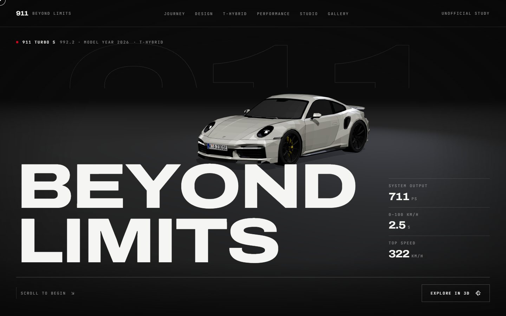

<div align="center">

# 911 — BEYOND LIMITS

**An immersive, cinematic study of the 2026 Porsche 911 Turbo S (992.2) — real-time 3D, a live light studio and scroll-driven storytelling.**


### [▶ Live demo — porsche-911-motion-experience.vercel.app](https://porsche-911-motion-experience.vercel.app)



</div>

> **Unofficial portfolio project.** Not affiliated with, endorsed by or connected to Dr. Ing. h.c. F. Porsche AG.
> Porsche, 911 and Turbo S are trademarks of their owner and are used for identification only.

## Features

| | |
|---|---|
| **One persistent 3D stage** | A single transparent React Three Fiber canvas lives behind the whole page. Sections request camera compositions; the car never reloads and transitions are seamless. |
| **Cinematic hero** | GSAP intro timeline: camera dolly-in, masked headline reveal, and a giant outlined *911* numeral that sits **behind** the car (backdrop → numeral → WebGL). |
| **Scroll journey** | One pinned chapter scrubs the camera through five compositions (front → profile → rear → wheel → plan) with crossfading copy. No snapping, no scroll hijacking. |
| **Design & aero hotspots** | Numbered hotspots anchored on the model, mirrored by an accessible list. Selecting one flies the camera to the detail and shows sourced text. |
| **T-Hybrid schematic** | A scroll-stepped SVG schematic of boxer, eTurbos, PDK motor, battery and axles — labelled as illustrative, not a simulation. |
| **Performance** | Animated counters and an SVG gauge for 711 PS · 800 Nm · 2.5 s · 322 km/h, with imperial values marked as conversions. |
| **Light Studio + configurator** | Studio / Night / Sunset rebuild the environment reflections and move real lights, fog and exposure. Paint, wheel finish and camera presets drive the real materials. |
| **Photo Mode** *(original feature)* | Visitors compose a shot and download a 2× PNG rendered straight from the live renderer. The gallery itself was produced with the same pipeline. |
| **Free camera** | Orbit / pinch-zoom the car; page scroll is frozen while exploring and restored on Esc. |
| **Gallery** | Editorial grid of renders with clip-path reveals, parallax and a keyboard/swipe lightbox. |

## Tech stack

React 19 · TypeScript (strict) · Vite 8 · Tailwind CSS 4 · Three.js · React Three Fiber 9 · Drei 10 · GSAP 3 + ScrollTrigger · Lenis · Motion (LazyMotion) · Lucide · Vitest · Playwright · oxlint

## 3D implementation

- **Model pipeline** — `scripts/optimize-model.mjs` (glTF-Transform) converts the downloaded glTF, whose materials are unlit game-style colours, into a **PBR GLB**: every primitive is re-materialed by role (`paint`, `glass`, `tyre`, `wheel_rim`, `chrome`, `caliper`, `headlight`, `taillight`…), wheel parts get their own materials, the baked shadow plane is removed and geometry is meshopt-compressed (≈ 400 KB).
- **Materials** — one shared `MeshPhysicalMaterial` with clearcoat for paint (colour eases on respray), dark coated glass, emissive lamps.
- **Lighting** — no HDR download: each mood is a procedural environment built from Drei `Lightformer`s, plus a shadow-casting key light and a coloured rim light. Switching mood regenerates the cube map and damps light colour/intensity/position, fog and tone-mapping exposure.
- **Camera** — a mutable *director* holds per-frame intent written by ScrollTrigger; `CameraRig` damps position, target and FOV frame-rate independently with subtle pointer parallax. Explore mode hands control to `OrbitControls`.
- **Performance** — the 3D chunk is lazy-loaded, the canvas pauses (`frameloop="never"`) while opaque sections cover it, DPR adapts via `PerformanceMonitor`, low-tier devices skip shadow maps. An error boundary and WebGL check fall back to a clearly labelled still render.

## Animation system

- Lenis is driven by the GSAP ticker and feeds `ScrollTrigger.update` — one clock, no desync.
- All timelines live in `useGSAP` scopes, so tweens and ScrollTriggers are reverted on unmount.
- Explicit `fromTo` values wherever a CSS transition or React StrictMode could corrupt `from` state.
- `prefers-reduced-motion`: native scroll, no intro, snapped camera, final counter values.
- Only `transform`, `opacity` and `clip-path` are animated in the DOM.

## Architecture

```
src/
  app/            App composition, CaptureView (deterministic render mode)
  animations/     director (camera intent), scroll/ (Lenis, reveals, stage triggers)
  components/     Navigation, Preloader, Cursor, UI primitives
  sections/       Hero, Journey, Design, Engineering, Performance, Studio, Gallery, Finale, Footer
  three/          scenes/, models/, materials/, lighting/, controls/, hotspots/, capture/
  data/           verified specs, sources, shots, hotspots, paints, environments, gallery manifest
  store/          tiny immutable stores (useSyncExternalStore)
  hooks/ utils/   media queries, device tiering, camera math, unit conversion
scripts/          optimize-model.mjs, capture-renders.mjs
e2e/              Playwright smoke tests (desktop + mobile)
```

## Getting started

```bash
npm install
npm run dev          # http://localhost:5173
npm test             # unit tests (Vitest)
npm run lint         # oxlint
npm run build        # type-check + production build into dist/
npm run e2e          # Playwright smoke tests against the preview build
```

Regenerate assets (optional):

```bash
npm run model:optimize                              # assets-src/sketchfab-911/scene.gltf -> public/models/911-turbo-s.glb
npm run renders:capture -- http://localhost:5173    # gallery renders, OG image, touch icon
```

## Deployment

Deployed on Vercel as a static Vite build (`npm run build` → `dist/`). `vercel.json` sets long-term caching for hashed assets and security headers (CSP, `X-Frame-Options`, `Referrer-Policy`, `Permissions-Policy`). No environment variables or secrets are required.

## Data sources

All figures come from the official [Porsche Newsroom press kit](https://newsroom.porsche.com/en/press-kits/pfv-porsche-911-turbo-s.html) and its [powertrain](https://newsroom.porsche.com/en/press-kits/pfv-porsche-911-turbo-s/Powertrain.html) and [aerodynamics](https://newsroom.porsche.com/en/press-kits/pfv-porsche-911-turbo-s/Body,-aerodynamics-and-design.html) chapters: 523 kW (711 PS), 800 Nm, 3.6-litre boxer, two eTurbos, 60 kW PDK motor, 400 V / 1.9 kWh battery, 0–100 km/h in 2.5 s, 322 km/h. Imperial values are derived conversions.

## Asset credits & licences

| Asset | Credit | Licence |
|---|---|---|
| 3D model | ["Porsche 911 Turbo S 992"](https://sketchfab.com/3d-models/porsche-911-turbo-s-992-b364d1710bc24c76ac0c613fbbaea8f0) by [S.K. (@Streetsraker)](https://sketchfab.com/Streetsraker) | [CC BY 4.0](https://creativecommons.org/licenses/by/4.0/) — modified: re-materialed to PBR, shadow plane removed, compressed |
| Gallery & OG renders | Rendered from this project's real-time scene using the model above | CC BY 4.0 (derivative of the model) |
| Fonts | Archivo, JetBrains Mono via Fontsource | SIL Open Font License 1.1 |
| Icons | Lucide | ISC |

## Known limitations

- **The model depicts the earlier 992.1 body**, not the 2026 992.2: headlights, front intakes and active aero differ. No freely licensed 992.2 Turbo S model was available; the copy describes the 992.2 from official sources.
- The model is low-poly (≈ 21k triangles) and game-styled; facets are visible in close-ups.
- Paint colours are artistic approximations — a visual concept, not an official configurator.
- The hybrid schematic is illustrative: positions are simplified and the animation shows involvement, not energy flow.
- Headless/CPU rendering (e.g. SwiftShader) is slow; a real GPU is expected for the full experience.

## Licence

Code is released under the [MIT License](LICENSE). The 3D model and renders keep their CC BY 4.0 licence (see credits above).
